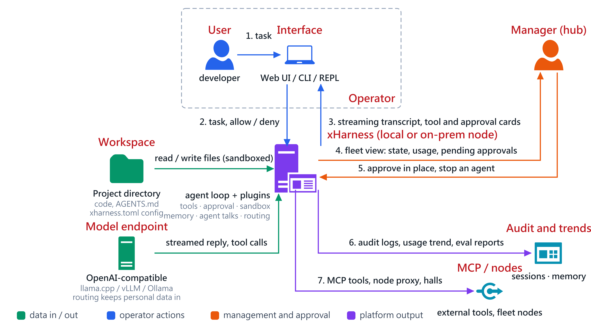
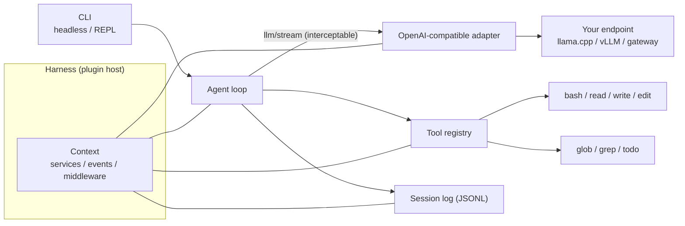

# xHarness

English | [中文](README.md)

[](https://github.com/guessleej/xHarness/actions/workflows/ci.yml)
[](LICENSE)
[](pyproject.toml)

xHarness is a plugin-based AI agent harness by xCloudinfo: governance-first, zero-dependency, "everything is a plugin", a compact Python package that runs against **any OpenAI-compatible endpoint** — llama.cpp (`llama-server`), vLLM, Ollama, LiteLLM, or a company gateway. Fully on-prem friendly: nothing leaves your machine except requests to the model endpoint you configure.

## How it is used



Left to right: the workspace and the model endpoint feed xHarness; an operator gives tasks and answers approvals from the Web UI or CLI (1–3); a manager watches several machines from the fleet hub and approves or stops agents in place (4–5); the platform emits audit logs and usage trends, and reaches external tools or other nodes through MCP (6–7).

## Why

Agent harnesses tend to hard-wire one vendor's API and ship a large dependency tree. xHarness keeps the architecture idea — tools, the model adapter, the session log, and the agent loop wiring are all plugins over a shared context — at a size one developer can audit: about 13,800 lines of Python (package code, excluding 6,020 lines of tests), **zero runtime dependencies** (standard library only, including the SSE streaming client, the TOML config reader, and the MCP client), and a 411-case test suite that finishes in about 33 seconds (most of it spent shutting down test HTTP servers, not computing).

## Features

- **Everything is a plugin.** Services, events, and tool registrations are contributed to a shared `Context`; unloading a plugin unwinds everything it registered.
- **Any OpenAI-compatible provider.** Streaming SSE with tool calls, per-request credential resolution from environment variables, configurable temperature and token caps.
- **Built-in tools.** `bash`, `read`, `write`, `edit`, `glob`, `grep`, `todo_write`, plus an opt-in `webfetch`.
- **Sandboxing.** `bash` is confined with OS facilities that are already installed: `sandbox-exec` (Seatbelt) on macOS, `bwrap` (bubblewrap) on Linux — writes are limited to the working directory and temp dirs, `allow_network = false` also cuts the network, and `mode = "require"` refuses to start without a backend.
- **MCP client.** Configure stdio MCP servers under `[mcp.servers.*]`; their tools join the registry as `mcp__{server}__{tool}`. Tools without a `readOnlyHint` are treated as side-effectful and go through the approval policy.
- **Approval policy.** Mutating tools (`bash`, `write`, `edit`, `webfetch`, MCP tools) ask before acting in interactive mode; `--yes` or `approval = "auto"` opts out.
- **Project instructions.** `AGENTS.md` (or `CLAUDE.md`) in the working directory is read into the system prompt automatically, so the agent follows each repo's own conventions; disable with `--no-instructions` or `project_instructions = false`.
- **Cost brakes (telemetry).** An `llm/stream` middleware counts tokens, tool calls, and latency per model call; `max_total_tokens` / `max_llm_calls` hard-stop a runaway task, the usage summary lands in the session log, and `/usage` shows it in the REPL.
- **Eval subsystem.** `xharness eval <dir>` runs a scored suite against any model: each case executes in a clean temp workspace and is graded by deterministic checks (files, answers, command results, whether tools were actually called) plus an optional LLM judge, reporting pass rate, per-case tokens and time, with JSONL output. The bundled `evals/basic` suite quantifies whether a model uses tools and follows instructions.
- **Subagents.** `subagent` delegates one bounded task to a fresh child agent; `subagent_batch` fans independent tasks out in parallel. Children share tools and model, cannot spawn children, and route every side effect through the parent's approval policy.
- **Agent roles, management and discussions.** Role files (Claude Code's subagent format) give an agent its instructions, tools, model and limits, and can only narrow permissions; the Agents tab shows what each agent is doing and spending and stops any of them; `discussion` lets agents talk to each other as a round table, debate, review or free discussion, with a verbatim record, every figure checked against a source, and disagreements kept.
- **Desktop app.** `xharness desktop` opens the same Web UI in the operating system's native window (WebKit on macOS, WebView2 on Windows, WebKitGTK on Linux), no browser tab; the server binds a loopback port only this process knows and stops when the window closes. `packaging/desktop/build.py` bundles it with PyInstaller into `xHarness.app` + `.dmg` (macOS) or `xHarness.exe` (Windows) for people without Python. The one optional dependency is pywebview (`pip install "xharness[desktop]"`). `[desktop] node = true` opens a second, token-protected listener on the same window, so a hub can see and steer the machine: usable and governable at once.
- **Web UI and fleet view.** `xharness web` serves a local interface: streaming transcript, tool cards, approval buttons, conversation, session, and memory lists, usage chips, light/dark theme. The fleet view shows every conversation and subagent on one page — state, usage, pending approvals — with inline approve/deny and a **stop** button per agent. Binds 127.0.0.1 by default; binding elsewhere requires `--token`.
- **Real-browser search and open.** Point `[tools] browser = "http://127.0.0.1:9377"` at a local camofox (a real Firefox) and two tools appear: `web_search` opens the DuckDuckGo results page in the browser and returns title / URL / snippet (no search API key), and `browser_open` returns the rendered visible text, so JavaScript-rendered pages are readable too. Both go through approval by default; `browser_approval = false` waives it.
- **Telegram channel.** Mount `[channels.telegram]` on a node and drive it from your phone: every chat is an ordinary conversation (visible in the fleet view, same approval policy and budget brake, same session log), and mutating tools arrive as allow / deny buttons; `POST /api/notify` lets the platform, a scheduler or any other system push a notification to your Telegram. Only chats listed in `allowed_chats` are served, everything else is ignored; the bot token is read from a file (`token_file`) or an env var, never from the config itself.
- **Multi-node fleet.** Every machine runs its own `xharness web` as a node; any machine whose config lists the nodes becomes a hub: its fleet view merges local and remote conversations, and approve / deny / stop are proxied through the hub. Node tokens live only in the hub's environment; the browser never sees them. `xharness fleet` prints the whole fleet in the terminal.
- **Usage history.** Session logs on disk are the source of truth (telemetry lands at the end of every task, covering CLI, headless, Web, and subagents); `xharness usage` aggregates tokens, model calls, and tool calls by hour or day, and the fleet view draws a trend line per node (one y axis, one fixed hue per node, crosshair tooltip, legend, table view), with the hub pulling each node's own history onto a shared time axis.
- **Provider catalog presets.** `preset = "ollama"` wires up llama.cpp, Ollama, vLLM, LM Studio, LiteLLM, or OpenAI, OpenRouter, Groq, Mistral, Together in one line; `xharness providers probe` checks each endpoint and lists the models it serves.
- **Memory layer.** Persistent memory across sessions: one Markdown file per fact under `~/.xharness/memory/` with a generated `MEMORY.md` index. The model sees the index (names and one-line descriptions) on every call and loads a memory in full only when it asks; `memory_write`/`memory_delete` go through approval and every change is recorded in `audit.jsonl` with the agent and session. `xharness memory` shows a human exactly what the agent remembers. Memories are grouped by **topic** with generated `topics/<topic>.md` pages; `xharness memory consolidate` finds duplicate, contradictory, or stale memories and proposes a merge plan — dry-run by default, `--apply` executes, `--llm` lets the model propose. Memories not confirmed or used for a long time are flagged **待確認** (stale, `stale_days`, default 90) for both the model and humans; `xharness memory verify` re-verifies them (optionally with the model, using newer memories in the same topic as evidence) and `memory expire` **archives** rather than deletes what is truly expired.
- **Append-only session log.** Every message and tool result is recorded as JSONL under `~/.xharness/sessions/`; `--resume <id>` continues a session.
- **Two run modes.** Headless one-shot (`xharness "task"`) and an interactive REPL.
- **Extensible.** User plugin modules add tools and services from config; `llm/stream` middleware intercepts every model call for caching, logging, or routing.
- **Multi-user, with quotas.** `[auth]` turns one machine into a service for a group: local accounts or the site's AD / OpenLDAP (an LDAP client written against the standard library), a private conversation and transcript directory per person, daily and monthly token allowances, temporary lockout after repeated failures, and an audit record for every sign-in and refusal. Without the section, single-operator behaviour is unchanged.
- **Service usage report.** `xharness report` and `GET /api/usage-report` produce the six blocks management asks for — who used it, what it cost, self-hosted vs bought-in, whether the hardware was used, whether outbound integrations are safe, system health and governance; `scripts/report/build_usage_report.py` renders it as Word or PDF. Estimates carry their assumptions, and the report lists the system's own problems.
- **Secret-handling self-check.** `GET /api/security-check` walks through where secrets live and who can read them, in plain language with the fix beside it, never showing a value; audit records and error messages pass through one masker.
- **No telemetry.** xHarness sends nothing anywhere except your configured model endpoint (and the `webfetch` tool or MCP servers you enable yourself). There is no anonymous id, no usage upload, no phone-home of any kind.

## Quickstart

Requires Python 3.11 or newer.

```sh
git clone https://github.com/guessleej/xHarness.git
cd xHarness
python3 -m venv .venv && ./.venv/bin/pip install -e .
```

Point it at any OpenAI-compatible endpoint. The fastest way is environment variables:

```sh
export XHARNESS_BASE_URL=http://localhost:8080/v1
export XHARNESS_MODEL=your-model-id
./.venv/bin/xharness "list the files in this directory and summarize the project"
```

Or copy `xharness.example.toml` (Chinese-commented version: `xharness.example.zh.toml`) to `xharness.toml` and edit it:

```toml
default_provider = "local"
approval = "prompt"

[providers.local]
base_url = "http://localhost:8080/v1"
model = "your-model-id"
# api_key_env = "XHARNESS_API_KEY"
```

Then:

```sh
xharness              # interactive REPL
xharness "task"       # headless one-shot
xharness sessions     # list saved sessions
xharness --resume 2026-08-22-ab12cd34   # continue a session
```

## Built-in tools

| Tool | Mutating | Purpose |
|---|---|---|
| `bash` | yes | Run a shell command; output capped, timeout bounded |
| `read` | no | Read a file with numbered lines, offset/limit for large files |
| `write` | yes | Write a file, creating parent directories |
| `edit` | yes | Exact-string replacement; ambiguous matches are refused |
| `glob` | no | Find files by glob pattern (`**`, `*`, `?`) |
| `grep` | no | Search file contents by regular expression |
| `todo_write` | no | Maintain a working todo list for multi-step tasks |
| `subagent` | yes | Delegate a task to a fresh child agent and return its answer |
| `subagent_batch` | yes | Run independent tasks in parallel children, one heading per task |
| `memory_write` | yes | Save a cross-session memory (name, one-line description, content) |
| `memory_read` / `memory_search` / `memory_list` | no | Read in full / keyword search / list the index |
| `memory_delete` | yes | Remove a wrong or obsolete memory |
| `memory_verify` | yes | Confirm a stale memory is still true; resets its verification date |
| `memory_consolidate` | yes | Tidy one topic: find duplicates / contradictions / stale entries and merge; without `apply` it only returns the plan |
| `security_scan` | no | Run bandit / pip-audit / gitleaks against a directory (missing scanners are skipped) |
| `ask_user` | no | Put a 2-4 option question to the person and wait (they may also type their own answer); with nobody attached it says so at once instead of blocking |
| `skill` | no | Load a skill (SKILL.md) in full, with the list of files beside it; the system prompt carries only each skill's name and one line |
| `terminal` | yes | Run a command in a shell that stays open: `cd`, `export` and `source .venv/bin/activate` carry over; on a timeout the shell restarts and the model is told |
| `job_start` `job_status` `job_wait` `job_stop` | start is approved | Long commands in the background (builds, tests, downloads) while the model keeps working; a finished job is announced with the next message |
| `goal_done` | no | Only in goal mode: report the goal done or blocked |
| `lsp` | no | Ask a language server: definition, references, hover, diagnostics, file outline |
| `workflow` | yes | A multi-step plan with dependencies, run by subagents in order, independent steps in parallel |
| `list_agents` `send_message` `interrupt_agent` | no / stop asks approval | See which agents are working in this conversation; send another agent a message (read at the start of its next step); stop an agent you started |
| `report` | no | Only for an agent that another agent started: send a finding to the agent that started it |
| `ralph` | yes | One objective in rounds, each by a fresh child that sees only the objective and the last round's handoff; progress lives in files in the working directory |
| `session_search` `session_read` | no | Search and read the person's own earlier conversations (never anyone else's) |
| `powershell` | yes | A one-off PowerShell command; present only where `pwsh` is installed. For state that carries over use `terminal` with `shell: "powershell"` |
| `schedule_add` `schedule_list` `schedule_cancel` | no | Reminders within a conversation, delivered as a new request when due (Web UI) |
| `web_search` | configurable | Opens the DuckDuckGo results page in a real browser and returns up to 10 results as title / URL / snippet; present only when `[tools] browser` is set |
| `browser_open` | configurable | Opens a page in a real browser and returns the rendered visible text (truncated at 40k); present only when `[tools] browser` is set |
| `webfetch` | yes | Fetch an http(s) URL as readable text; **disabled by default** (`[tools] webfetch = true`) — enabling it is the only egress besides the model endpoint, and every fetch goes through approval |

Approval applies to mutating tools only. In headless mode the default is `auto` (nobody is watching a pipe); in interactive mode the default is `prompt`. An explicit `--approve prompt|auto` always wins.

## Sandbox

Commands from the `bash` tool run confined when a backend is detected (`sandbox-exec` on macOS, `bwrap` on Linux): the filesystem is read-only except the working directory and temp dirs. The REPL banner shows the active sandbox.

```toml
[sandbox]
mode = "auto"          # auto (default) | require (refuse to start without a backend) | off
allow_network = true   # false also cuts the network inside bash commands
```

`auto` falls back to bare execution where no backend exists (say, a container without bwrap) — use `require` to make confinement a hard guarantee.

## MCP servers

Any stdio MCP server can contribute tools:

```toml
[mcp.servers.fs]
command = "npx"
args = ["-y", "@modelcontextprotocol/server-filesystem", "/data"]
# env = { KEY = "value" }
# timeout_seconds = 60
```

Tools appear in `/tools` as `mcp__fs__read_file` and the like. MCP tools without a declared `readOnlyHint` are treated as side-effectful and gated by the approval policy; a server that fails to start is skipped with a warning instead of taking the harness down.

## Web UI and fleet view

```sh
xharness web                          # http://127.0.0.1:3080, opens a browser
xharness web --port 8090 --no-open
xharness web --host 0.0.0.0 --token <long-random-string>   # non-loopback binding requires a token
```

The UI is one zero-dependency page in three parts: a collapsible **task list** on the left (waiting for you / running / opened this session / earlier, searchable, one click to resume); the **conversation** in the middle, with one line per tool call ("read README.md", "edit notes.md +3 −1") that opens to its arguments and result, and replies rendered as markdown with tables and code; and a **review pane** on the right listing every file the task changed with its diff, plus files, tools and memory.

**Approvals show the diff**: when the agent is about to write or edit a file, the approval card contains the before-and-after, so you allow or deny with the change in front of you (`-y` makes it fully automatic). While a task runs, the send button becomes a stop button. The composer guards against IME Enter (no accidental sends mid-composition); light and dark follow the system and can be switched from the avatar menu.

**Fleet view** (top bar, "艦隊"): one card per conversation — state (running / waiting for approval / idle), task preview, tokens, calls, tool count, elapsed seconds, active subagents — under a row of totals. Pending approvals can be allowed or denied right on the card, and any running agent can be stopped: it halts before its next model call and pending approvals are denied (an in-flight model request cannot be interrupted; the loop exits when it returns).

Security: loopback by default, non-loopback `Host` headers rejected (DNS rebinding), every POST needs a custom header (cross-site form posts), tokens only in `Authorization`, SSE authenticated with 60-second single-use tickets. Details in [docs/ssdlc.md](docs/ssdlc.md).

## Desktop app

```sh
pip install "xharness[desktop]"
xharness desktop
```

Same config file (`./xharness.toml`, then `~/.xharness/config.toml`), same approvals, same session log, same fleet view — in a native window. Without a config file the window shows how to create one.

To hand it to people without Python:

```sh
pip install -e ".[build]"
python packaging/desktop/build.py
```

macOS yields `dist/xHarness.app` and `dist/xHarness-<version>.dmg` (icon rendered from the brand SVG when `rsvg-convert` is installed, otherwise no icon); Windows yields `dist/xHarness/xHarness.exe`. The bundle is unsigned: on macOS allow it once under System Settings → Privacy & Security.

## Multi-user (a shared machine: a school, a department)

Without `[auth]`, xHarness is one person's tool and behaves exactly as before.
With it, one machine serves a group and can still say who used what:

```toml
[auth]
backend = "local"                        # or ldap, for the site's AD / OpenLDAP
default_quota_tokens_per_day = 500000

[auth.users.itadmin]
role = "admin"
```

```sh
xharness users add itadmin --role admin   # the password is typed, never an argument
xharness users add teacher1 --display "Ms Chang"
xharness web --host 0.0.0.0               # with [auth] no shared token is needed
```

Once people sign in:

- **Each person's work is visible only to them.** Conversations, transcripts and
  usage return their own; transcripts live in separate directories
  (`sessions/u/<user>/`) rather than being filtered at query time. Admins see all.
- **Each person has their own allowance.** `quota_tokens_per_day` / `_per_month`
  accumulate across tasks and restarts and hard-stop before the next model call,
  so one person cannot spend the department's capacity.
- **Every sign-in, refusal and lockout lands in `access-audit.jsonl`.** Repeated
  failures lock the account temporarily. Disabling an account keeps its history
  attributable; deleting it would orphan the usage.

With the directory backend no password material stays on the machine:

```toml
[auth]
backend = "ldap"

[auth.ldap]
url = "ldaps://ad.school.edu.tw"
user_dn = "{user}@school.edu.tw"
```

The LDAP client exists for exactly this and does exactly one thing: check whether
a password is right. No searching, no attribute mapping — roles and quotas stay in
the config. Empty passwords are refused before connecting (an empty simple bind is
an anonymous bind, which most servers answer with success), DN templates accept a
strict character set only, and `ldaps://` verifies the certificate chain by default.

## Letting the model ask instead of guess

When a model is missing a fact -- how this system works, which of two files you meant -- its default is to fill the gap with something plausible, and an invented command or path costs far more than a question. `ask_user` gives it a legitimate alternative: put a 2-4 option question to you and carry on with the same task once you answer.

The question appears wherever you are:

| Front end | How to answer |
|---|---|
| Web UI / desktop | A question card in the transcript; click an option or type your own (IME-safe input) |
| Fleet view | Answer on the card, for this machine or any node (the hub forwards it) |
| Telegram | One button per option; a plain text reply also counts and does not start a new task |
| Terminal | Numbered options; type a number or your own words |
| Unattended (pipelines, schedules, evals) | The model is told at once that nobody is there, and asked to state its assumption or stop -- it never blocks waiting |

The default system prompt also asks the model, when a task gives a relative date ("next Friday", "in two weeks") that will be written into a file or message, to work out the exact date and confirm it with you before writing. Measured: granite turned "下週五" (next Friday) into the wrong date in 8 of 8 runs; you catch that at a glance, a file does not.

If nobody answers within 15 minutes or the task is stopped, the model is told there was no answer and not to ask again. Subagents do not get the tool: a parallel batch asking you questions at once would bury you, so they report what they are missing to the parent, which decides whether to ask.

The default system prompt tells the model to use `ask_user` rather than end its turn with a question, and never to fill such a gap with an invented command, path or fact. In practice models do not always comply and often still ask in prose -- that works too (reply with your next message), it just loses the option buttons and is invisible to an unattended run. To make the tool stick, say it again in the project's `AGENTS.md`.

## Skills, commands and long conversations

**Skills**: a folder holding `SKILL.md` is a skill, in the same layout as Claude Code and Codex, so existing skills work unchanged. They are found in the working directory's `.xharness/skills/` or `.claude/skills/` (a person's own), the server directory's `.xharness/skills/` (site-wide) and `$XHARNESS_HOME/skills/` (this machine); on a name clash the earlier wins. The system prompt carries only names and one line each; the model loads a body and its file list with the `skill` tool when a task matches, so twenty skills cost a few hundred tokens. In testing granite does not always load one unprompted, the same compliance limit as `ask_user`; naming the skill in `AGENTS.md` is the reliable way.

**Slash commands**: typing `/` in the composer opens the command list (arrow keys, Enter). Commands are handled by xHarness and never sent to the model; the terminal uses the same set.

| Command | Does |
|---|---|
| `/compact` | Summarise older messages so a long conversation can go on |
| `/model [name]` | Show the model, or switch to another configured one (also in the selector) |
| `/skills` | List the available skills |
| `/title [title]` | Show or change the conversation's title |
| `/feedback up\|down [note]` | Rate the last reply (each reply also has buttons) |
| `/export` | Download the conversation as Markdown |
| `/new` `/stop` `/tools` `/memory` `/usage` `/help` | New task, stop, tools, memory, usage, all commands |

Something that looks like a command but is not one, such as `/stop` in the terminal, is answered with "no such command" instead of being sent to the model. Measured: handed `/stop` as a request, xVITA reported editing two files without calling a single tool.

**Long conversations**: with `context_tokens` set on a provider, once a prompt passes 80% of it xHarness has the same model summarise the older part before continuing; a context-overflow error is also answered by a summary first and by dropping old tool output only if that is not enough. The summary is in the session log, and a resumed conversation is rebuilt at the same point.

**Switching models**: with several `[providers.*]`, a conversation's model can be changed from the composer or with `/model`. Each task's usage records which model ran it, so the usage report's self-hosted vs bought-in split follows the model actually used. A tier can be limited with `providers = [...]`, for example students to the on-premises model only.

**Titles, search, export, ratings**: after the first task the conversation's own model writes a short title; the task-list search covers the requests, replies and titles of every earlier conversation; a conversation can be exported as Markdown. Each reply can be copied, rated up or down, and given a note. Ratings are a record for people and never reach the model; the usage report's health block counts them and lists the latest notes on poor answers.

## Plans, goals, background jobs and images

**Plan mode**: the "計畫模式" button next to the composer, or `/plan`. While it is on, every tool that changes something (write, edit, commands, background jobs, subagents) is withdrawn; the model can only look, and ends with a numbered plan. An "approve and run" button under the reply turns plan mode off and carries the plan out. A call to a withdrawn tool is refused even if the model tries. In testing granite got a weekday wrong in its plan -- which is what this step is for.

**Goal mode**: `/goal objective` (up to 5 rounds by default, `/goal --rounds 8 objective`, at most 20). Whenever the model stops without calling `goal_done` to report the goal done or blocked, xHarness gives it another round, until it is done, blocked, out of rounds or stopped. A banner shows the round. The round count is explicit on purpose: `/goal 2026 年的報表` does not read 2026 as rounds.

**Background jobs and the terminal**: `job_start` runs a long command in the background, logging to `.xharness/jobs/` in the working directory; the review pane's background tab shows progress and a stop button. At most 4 at once and 2 hours each (`[jobs]` adjusts), stopped when the conversation ends, and a finished job is announced to the model with your next message. `terminal` is a shell that stays open, sandboxed and approved like bash.

**@files**: typing `@` in the composer lists the working directory's files; the chosen file's text goes with the message (text files inside the working directory only, 20,000 characters each, 60,000 in all); `@picture.png` is attached as an image.

**Images**: paste, drop or attach images in the composer (4 per message, 5 MB each). A provider with `vision = true` sees them directly; for one that cannot, `[vision] provider = "…"` names a model that turns each image into a written description first. In testing the xReadable OCR model on .70 transcribed an error screenshot word for word and granite worked out the troubleshooting steps from it. With neither, the model is told plainly that it cannot see the images instead of guessing.

## Hooks, editors, language servers, reminders and workflows

**Hooks**: Claude Code's hook protocol, so existing hook scripts work unchanged. `SessionStart`, `UserPromptSubmit` (add context or block the request), `PreToolUse` (allow without the approval prompt, force the prompt, or deny), `PostToolUse` (add a note after the result), `Stop` (keep the agent going, at most 3 times a task) and `PreCompact` (veto). Scripts get JSON on stdin; exit 2 blocks and its stderr is the reason the model sees; a matcher may say `Bash` or `bash`. Codex's `notify` is supported too. Hooks come **only from the operator's configuration** (`[[hooks.PreToolUse]]`, or `[hooks] files = ["~/.claude/settings.json"]`); a repository the agent works on cannot register one, or any checked-out project could run commands on the server.

```toml
[[hooks.PreToolUse]]
matcher = "Bash"
command = "/opt/policy/check-command.sh"
```

**Refused tools stop burning turns**: a tool refused 3 times in a task (by a hook, the approval policy or plan mode), or called 12 times in a row with the same arguments, is withdrawn for the rest of that task and the model is told to try another way or say what it could not do. Measured: with bash blocked by a hook, granite retried it 37 times until the turn limit; with the breaker it changed approach after 3 and said plainly what it could not do.

**Editors (ACP)**: `xharness acp` lets an editor that speaks the Agent Client Protocol, such as Zed, use xHarness directly: streamed replies, every tool call shown in the editor (with a diff for writes and edits), and approvals as the editor's permission prompts (allow once, always allow, reject). Zed:

```json
"agent_servers": { "xHarness": { "command": "xharness", "args": ["acp"] } }
```

**Language servers (LSP)**: the `lsp` tool starts an installed server for the file's language on first use (pyright, pylsp, typescript-language-server, gopls, rust-analyzer) and keeps it for the conversation: definition, references, hover, diagnostics and outline. A position can be a line plus the name on it; no column counting. Measured against pylsp on this repository: about one second per query. `[lsp.servers.<name>]` configures others.

**Reminders**: `/remind 30 check the training run`, or ask the model to look again in half an hour (it uses `schedule_add`). When due, the reminder arrives as a new request marked as a reminder rather than something a person typed; it can repeat every N minutes for a set number of times. Reminders are in the session log, restored when a conversation is resumed and caught up if they came due meanwhile. They need the Web UI holding the conversation; in the terminal the model says it cannot set one instead of promising.

**Workflows**: with `workflow` the model breaks work into steps with dependencies (read three modules, then design the change, then update code and tests in parallel, then review), run by subagents in order with independent steps in parallel; each step receives the results of the steps it depends on, and a failed step skips everything built on it.

## Long tasks that do not wedge themselves

These follow patterns from [DeepSeek Harness](https://github.com/deepseek-ai/deepseek-harness), aimed at what self-hosted models in a school server room actually do:

| Situation | What xHarness does |
|---|---|
| Model server restarting, load balancer answering 502/503, rate limit 429 | Retries twice (2 s, then 6 s; honours `Retry-After` up to 30 s). Only before the response starts, so streamed text is never repeated. 400, 401 and unknown hosts fail at once |
| One command printing tens of thousands of characters | Tool output over 16,000 characters is saved in full under `.xharness/spill/` in the working directory; the model sees the head, the tail and the file name, and can `read` the middle in pages. The directory carries its own `.gitignore` and keeps the latest 20 files |
| A conversation outgrowing the model's context | When the model reports the context is exceeded, older tool outputs are replaced by a one-line note and the request is sent again, keeping the latest two; the originals stay in the session log |
| The model calling the same tool with the same arguments again and again | Calls 3, 5 and 8 get a note that the result will not change and to try something else or ask -- advice only, nothing is blocked |
| A conversation left open overnight | The first message after the date changes carries today's date, so the model does not take yesterday for today |

Everything the model sees goes into the session log, the system prompt (identity, date, `AGENTS.md`) included, so "what was the model told" has an answer afterwards.

## User tiers and uploaded files

With `[auth]` on, each person gets a **working directory** of their own alongside their conversations and quota:

```
$XHARNESS_HOME/
  workspaces/u/<user>/          ← where this person's agents work
       uploads/                  ← files uploaded from the browser
  sessions/u/<user>/             ← their transcripts
```

The isolation is a filesystem boundary, not a query-time filter: a teacher's agent has `workspaces/u/teacher_chen/` as its working directory, so `read`, `write`, `glob` and `bash` all stay inside it. Without `[auth]`, the agent uses the directory the server was started from, exactly as a single-operator install always has.

**Uploading**: there is a paperclip button beside the input, and files can be dropped straight onto the composer. Uploaded files are listed under the message and their paths are appended when you send:

```
Take a look at this grade distribution

I have uploaded these files, please read them with the read tool:
- uploads/grades.csv
```

The side panel's file list shows what is stored, how much space it uses, and lets you re-attach or delete. Every upload is written to `access-audit.jsonl`.

```toml
[files]
max_file_mb = 25
max_total_mb = 500
retention_days = 0           # 0 keeps uploads until someone deletes them
```

Omitting `allowed_extensions` uses the built-in allow-list (documents, data, images, common source files). **Executables are not on it**, and uploaded files are never executed. Names are sanitised before anything is written: path separators and control characters are stripped, and a repeated name is numbered rather than overwriting.

**Tiers**: the built-in `admin` and `user` are always available; define the ones a site needs under `[auth.roles]`:

```toml
[auth.roles.principal]
label = "Head of school"
admin = true

[auth.roles.teacher]
label = "Teacher"
quota_tokens_per_day = 200000

[auth.roles.student]
label = "Student"
quota_tokens_per_day = 30000
deny_tools = ["bash", "write", "edit", "security_scan", "subagent", "subagent_batch"]
```

A denied tool is **absent**, not refused: it never appears in the model's tool list, so a restricted account is never promised something that then fails. Quotas resolve most-specific-first: the person, their stored record, their tier, then the site default.

## Service usage report

The one for a dean, a department head or a customer's management. Six blocks,
every figure computed from the harness's own records: who used it, what it cost,
self-hosted vs bought-in, whether the hardware was used, whether outbound
integrations are safe, system health and governance.

```sh
xharness report                                   # in the terminal
xharness report --since 30d --json report.json    # JSON for the builder
python3 scripts/report/build_usage_report.py report.json -o usage-report.docx
python3 scripts/report/build_usage_report.py --url http://node:3080 \
    --token-file ~/.xharness/node-token --pdf     # straight from a node, as PDF
```

The Web UI's admin tab shows the same report and can download the JSON. The
endpoint is `GET /api/usage-report?since=30d` (administrators only).

An estimate always carries its assumption: with no `cost_per_1k_tokens` configured
the block says so rather than showing a confident zero. The report also lists the
system's own problems — unattributed usage, unreachable nodes, hardware idle for
the whole period, failed sign-ins — because a report that only brings good news
does not get read twice.

The builder needs `python-docx` (and `matplotlib` for the charts); neither is a
runtime dependency of xHarness.

## Secret-handling self-check

`GET /api/security-check` (administrators only), or the first panel of the Web UI's
admin tab. Every check is about where secrets are and who can read them, in plain
language with the fix beside it:

- secrets written straight into the config file (use `api_key_env` / `token_file`)
- secrets in URLs (`?api_key=` survives in access logs, proxies and browser history)
- permissions on the account file, node token files and the session directory
- whether an exposed binding requires a token or a sign-in
- the sandbox mode (`auto` falls back to no sandbox where no backend exists)
- whether LDAP is encrypted and verified

The page never shows a secret's value, only whether one is in the wrong place.
Audit records, error messages and transcripts all pass through one masker first, so
bearer tokens, secrets in URL query strings, `sk-` / `hf_` / `ghp_` shapes and
connection-string passwords are never written down.

## Subagents

The model can delegate sub-problems so their details do not flood its own context:

```toml
[subagent]
max_workers = 4   # parallelism for subagent_batch
max_turns = 20    # per-child turn limit
```

Children share tools, model, telemetry, and the session log (events tagged with the `agent` name; `--resume` rebuilds only the main line). Children cannot see the `subagent` tools, so there is no unbounded recursion, and every side effect goes through the parent's approval policy — a `prompt`-mode parent still asks you.

### Background subagents and messages between agents

`subagent` with `background: true` does not wait: the child works in the background (read-only -- it cannot change anything, since nobody sits at an approval prompt for it), the parent carries on, and the child's reports (`report`) and final answer arrive as messages "from agent X" at the start of the parent's later steps. At most 4 at a time. `list_agents` shows who is doing what, `send_message` passes a note, `interrupt_agent` stops an agent you started. A message is capped at 4,000 characters, each agent holds at most 20, and they are labelled as coming from an agent, not the person.

### ralph: work in rounds

Hand a long, checkable job (make the tests pass, convert a batch of files) to `ralph`: every round is a fresh child that sees the unchanged objective, which round it is, and the previous round's handoff; what earlier rounds did is not remembered by conversation but kept in the working directory (files, tests, git). Each child ends with `STATUS: complete | continue | blocked` and `HANDOFF:`. Rounds default to 5, at most 10 (`[subagent] ralph_rounds`); the result is `complete`, `blocked` or `budget-limited`.

## Agent roles, agent management and discussions

### Agent roles

Write an agent you use often as a Markdown file in `.xharness/agents/` (in the working directory, the site, or `$XHARNESS_HOME`; Claude Code's `.claude/agents/` is read too). The format is Claude Code's subagent format:

```markdown
---
name: analyst
description: Looks up indicators and states only the figures it found
tools: read, grep, glob        # optional; Claude Code's Read, Grep work too
model: granite                 # optional; a name from [providers.*]
max_turns: 12                  # optional
max_tokens: 40000              # optional, this agent's token ceiling
---
You analyse institutional indicators. Look the data up before you answer and quote figures exactly, with their source.
```

`subagent`, `subagent_batch`, every `workflow` step and every discussion participant take `agent: analyst`; the model sees the list of roles in its system prompt. A role can only **narrow** what an agent may do: its tool list is intersected with the tools the person already has (a tier's denied tools are gone before that), and its model must be configured and allowed for this person; otherwise the caller's model runs it and the result says so.

**Four ready-made roles**: `examples/agents/` in the repo holds `查資料員` (researcher), `審查員` (reviewer), `正方` (for) and `反方` (against) -- role names may be in any script; copy them into the site's `.xharness/agents/` to give them to everyone:

```bash
mkdir -p .xharness/agents && cp examples/agents/*.md .xharness/agents/
```

### Managing agents

Every conversation registers the agents working for it: children, workflow steps, discussion participants. In the Web UI, Review → Agents lists each one's role, model, what it is doing, tokens and calls, and stops one, a whole discussion, or all of them; the conversation's Stop button stops them all too. In the terminal `/agents` lists them and `/agents stop` stops them. Each agent leaves an `agent-run` record in the session, and the usage report breaks spending, failures and stops down by role.

### Discussions: agents talking to each other

The `discussion` tool has several agents speak to one topic in turn, in four forms:

| Mode | How it runs | When it ends |
|---|---|---|
| `roundtable` | everyone speaks each round | rounds run out, or a whole round answers 【無補充】 (nothing to add) |
| `debate` | sides argue in turn (for/against assigned when not given); the moderator gives a verdict | rounds run out |
| `review` | the first participant writes, the others review, the author revises | every reviewer answers 【通過】 (approved), or rounds run out |
| `free` | the moderator picks who speaks next | the moderator calls it (only after everyone spoke), or the turn budget runs out |
| `teams` | each round, every team first talks internally (the other teams cannot see it), then its spokesperson speaks to everyone; the next internal round starts from what the other teams said in public | rounds run out |

Team against team: 2-4 teams of one or more members (8 at most in all); the spokesperson is the first member unless named, and a one-member team simply speaks in public. The summary gives each team's final position and whether another team's argument changed it. For example "開一場組對組討論：教務組（正方、查資料員）對學務組（反方、審查員），題目：要不要開夜間班，兩輪".

Ask in plain words, for example "have 正方 and 反方 debate whether to cut the intake, two rounds, check 招生數據.csv first". Each participant is an agent of its own, with its own conversation, role or brief, tools and model, and can look things up before it speaks; on each turn it is told only what was said since it last spoke.

What keeps a discussion accountable:

- **A verbatim record.** Every utterance, with speaker, round and the tools used, goes into the session (`discussion-turn`), shows live in the Web UI, and `/export` produces the full transcript plus a table of agent runs.
- **Figures and sources must be found.** Every number and every named source ("資料來源：…", "出自「…」") in an utterance is checked against what the room actually has: the topic, the caller's background, the participants' instructions, the files read, and every tool result so far. A participant that quotes without looking anything up is told which ones and asked to check and say it again in full; what still has no source is marked unverified, pointed out to the next speakers, and may not appear in the summary as agreed.
- **Limits.** Rounds (default 3, at most 8), a token allowance per discussion (moderator included), model calls per utterance; the global budget brake and per-person quotas still apply.
- **Disagreement is kept.** The summary separates what was agreed, where people disagreed (by name), and what still needs checking; a debate adds a verdict, a review its outcome.
- **Stoppable.** Stop one participant and the others go on; stop the room and it ends at once, summary included.

### Team against team across conversations and machines (halls)

A team in a team-against-team discussion can be played by **another conversation**: another one on this node, someone else's, or xHarness on another machine.

1. The hosting side says "our team is 教務組 (正方, 查資料員); 學務組 joins from another conversation". The discussion block shows an **invite code** (starting `xhall:`) with a copy button, and which teams it is waiting for.
2. The other conversation, on any machine, pastes it: "join the hall xhall:…, we are 學務組: 反方, 審查員".
3. Each side runs on its own: every team's internal talk uses **its own machine's members, tools, data and model** and stays in its own conversation; only the spokesperson's public statements go to the hall, which relays them to the other teams. The host writes the summary and both sides receive it. Statements from elsewhere are labelled with their origin and "figures checked by them".

The joining side always calls the hall: .27 joining a hall on .70 only needs .27 to reach .70. Halls use their own credentials instead of accounts: the invite only joins, and stops working when the discussion starts; each joined team gets a token that can read that hall's public record, post its own statement, and leave. The invite is shown on screen and never written to the record. Only the Web UI can host a hall; the terminal can join one.

```toml
[web]
public_url = "http://192.168.10.70:3080"   # an address other machines can reach; defaults to the one the browser used

[discussion]
join_minutes = 10         # how long to wait for other conversations to join
turn_minutes = 15         # how long to wait for a remote spokesperson
```

```toml
[agents]
enabled = true
dirs = []                 # other directories holding role files

[discussion]
enabled = true
max_rounds = 8
max_tokens = 200000       # per discussion, moderator included
speak_turns = 6           # model calls per utterance, lookups included
```

## Model routing

When the config lists several models (this machine, a private cloud, a bought-in service) xHarness can pick one per request. Off by default; once on, the Web UI's model menu gets "auto" at the top, and picking a model by hand pins it.

The choice is made in three layers, strictest first, because they fail differently:

1. **Hard rules, decided by code, never by a model.** A model that says "not sensitive" wrongly once has leaked once.
   - A model the account's tier does not offer is out (the existing user-tier `providers`).
   - A model whose origin is in `deny_origins` is out (default `["cn"]`: government and customer deliveries may not use China-origin models; only internal research relaxes it).
   - A **public** model (`where = "public"`) never sees personal data, keys or internal addresses (national ID, mobile number, e-mail, card number, API keys, internal IPs, plus your own `sensitive_words` / `sensitive_patterns`), and by default nothing that came from this machine: files read, tool results, attachments, pictures, hook output (`external_sees = "prompt"`; `"all"` lets files out, the personal-data rule still holds). A conversation that has touched local material stays marked, even after its history is compacted into a summary.
   - A public model gets a minimal system prompt (no project instructions, working directory or memory) and none of the `mcp__` tools.
   - A model that cannot call tools, or whose context is too small, is out.
   - If nothing is left the request fails with the reason. It is **not** sent to a model that was ruled out.
2. **Capability and cost, among what the rules left.** The request is rated easy, medium or hard (words, length, how long the tool loop has run); the cheapest model strong enough wins, own hardware first on a tie. An optional small **decider** model settles the ambiguous middle (`decider`; it must be self-hosted because it reads every request; it answers one word, and anything else leaves the rule-based rating).
3. **Failure.** A model that cannot be reached is skipped for a while (`health_cooldown_seconds`) and the next in the ranking takes over -- only before any text was produced, so a reply is never stitched from two models.

```toml
[routing]
enabled = true
default = "local"             # wins ties; the first model by default
prefer = "cost"               # cost (cheapest strong enough) or quality (strongest)
external_sees = "prompt"      # prompt: public models see only what you type; all: files and tool results too
deny_origins = ["cn"]
sensitive_words = ["學號", "病歷"]          # never sent to a public model
# sensitive_patterns = ['\bPJ-\d{4}\b']  # regular expressions
decider = "small"             # optional: a small model on your own hardware for the medium middle
health_cooldown_seconds = 120

[routing.models.local]        # the name matches [providers.local]
where = "local"               # local | private | public; by address when omitted (127.* local, LAN and Tailscale private, else public)
strength = 1                  # 1 easy, 2 medium, 3 hard
cost = 0                      # relative price; 0 for your own hardware
origin = "tw"                 # for deny_origins
tools = true                  # false: cannot call tools

[routing.models.cloud]
strength = 3
cost = 5
origin = "us"
```

**Example:** [`examples/routing/school-demo.toml`](examples/routing/school-demo.toml) (a main model with a stand-in, as the school demo site runs; loads as a whole), and the [school and public-sector deployment guide](docs/deployment-school.zh.md) (Chinese).

**Seeing and checking it:** `xharness route "refactor this module, student A123456789"` calls no model and prints the rating, the choice, the fallbacks, and who was excluded and why; in a conversation `/route` shows the last decision and what is down, `/model name` pins and `/model auto` restores. Every decision is written to the session (`route`, `route-fallback`: categories only, never the text that matched); the usage report and the Word report count decisions per model, requests kept off public models because of personal data or local files, and fallbacks; the security check says what public models can see, whether `where` agrees with the address, and whether China-origin models are blocked.

**Limits:** the difficulty rating is crude rules -- try your own requests with `xharness route` before trusting it, and the decider too (small models often rate "tidy this folder" as hard); pictures are always put into words by the `[vision]` describer unless every routed model can see; a role file's `model:` bypasses routing.

## Multi-node fleet

On each node (a machine you want to watch) — non-loopback binding requires a token, which need not appear on the command line:

```sh
XHARNESS_WEB_TOKEN_FILE=/run/secrets/xharness-node xharness web --host 0.0.0.0 --port 3080 --no-open
```

On the hub (any machine) — list the nodes in `xharness.toml`, referencing tokens by environment variable name:

```toml
[fleet]
name = "hub-office"                 # this machine's label in the fleet view (default: hostname)

[fleet.nodes.farm]
url = "http://10.0.0.5:3080"
token_file = "~/.xharness/node-tokens/farm"   # a 0600 file; or token_env = "XHARNESS_NODE_FARM_TOKEN"
# timeout_seconds = 3
```

```sh
xharness fleet                      # terminal: per node up/DOWN, latency, conversations, running, waiting, tokens
xharness web                        # the fleet view gains a "節點: farm" section; cards approve / deny / stop in place
```

Trust model: the hub forwards exactly two actions (approvals, stop) on an allow-list with validated conversation ids; a node answering a hub does not poll its own nodes (no recursion); "open on node" opens that node's own UI, which has its own authentication. Plain http is acceptable inside a LAN; put a TLS reverse proxy in front of nodes across network boundaries.

## Usage history

```sh
xharness usage                       # last 7 days by day: tokens, model calls, tool calls, tasks
xharness usage --since 24h           # last 24 hours by hour
xharness usage --since 30d --nodes   # plus every configured fleet node
```

The source is the `telemetry` events in `~/.xharness/sessions/*.jsonl` (the cumulative usage the telemetry plugin writes at the end of each task); consecutive entries within a session are differenced into per-task usage, so no web server needs to be running and headless and subagent traffic count too. `GET /api/usage?since=7d` returns local history, `GET /api/fleet/usage` is the hub's merge of every node; the fleet view's "用量趨勢" section switches 24h / 7d / 30d and chart / table. Eval cases run on throwaway harnesses without sessions and are not counted.

## Provider catalog presets

```toml
[providers.local]
preset = "ollama"          # fills defaults only: base_url and api_key_env; the model is always yours
model = "your-model"

[providers.cloud]
preset = "groq"            # hosted presets send prompts off-machine; opt-in by nature
model = "llama-3.3-70b-versatile"
# explicit base_url / api_key_env override the preset
```

```sh
xharness providers presets   # built-in presets (local / hosted, base_url, key env var)
xharness providers probe     # GET /models on every configured provider, list what it serves
xharness providers probe cloud
```

Built in: `llama-cpp`, `ollama`, `vllm`, `lmstudio`, `litellm` (local); `openai`, `openrouter`, `groq`, `mistral`, `together` (hosted).

## Memory

Memory is for humans to read: `~/.xharness/memory/<name>.md`, one fact per file with a small front matter (name, description, kind, updated) followed by the body; `MEMORY.md` is a generated index. The model sees the index in its system prompt on every call (size-capped; overflow says "use memory_search") and only loads a memory in full when it calls `memory_read` — memory never silently floods the context.

```sh
xharness memory                 # the index: what the agent remembers, grouped by topic
xharness memory topics          # topics and their memories
xharness memory show fav-editor # one memory in full
xharness memory search deploy   # keyword search
xharness memory audit           # who wrote, deleted, or consolidated what, in which session
xharness memory consolidate ops          # merge plan for topic ops (dry run)
xharness memory consolidate ops --llm    # plus model proposals (duplicates, contradictions, stale)
xharness memory consolidate all --apply  # execute the plans for every topic
xharness memory stale                    # memories not confirmed or used for a long time
xharness memory verify deploy-target     # a human confirms one is still true
xharness memory verify ops --llm         # the model judges stale ones against newer memories (dry run)
xharness memory verify all --llm --apply # apply only "verify" verdicts; contradictions are never auto-deleted
xharness memory expire --apply           # archive memories older than expire_days into memory/archive/
```

### Expiry and re-verification

A memory's freshness is the latest of `verified`, `updated`, and its last `memory_read`. Past `stale_days` it is **stale**: flagged in the index, in `MEMORY.md`, and in the Web panel, and the system prompt tells the model to treat it with caution and call `memory_verify` once confirmed. Three ways to re-verify: by hand (`verify <name>`); model-assisted (`verify <topic> --llm`), which uses only **newer** memories of the same topic as evidence and returns `verify` / `contradicted` / `unknown` — `--apply` acts only on `verify`, contradictions are listed for a human; and past `expire_days` (off by default) `expire --apply` archives them, **never deletes**, audited as `expire`.

### Topics and consolidation

Every memory has a `topic` (default: its `kind`). `MEMORY.md` is sectioned by topic and `topics/<topic>.md` are generated pages that concatenate a topic's memories in full, so a person reads one subject in one place instead of opening a dozen files.

Consolidation has two layers: a **deterministic** one finds near-duplicate memories by text similarity and folds them into the newer (on a tie, fuller) one; a **model** layer (`--llm`, or the tool's `use_model`) reads the whole topic and proposes merges and deletions with reasons, but may only reference names that exist in the topic — anything else is dropped. A plan is always shown before it runs: the CLI is dry-run by default, the agent's `memory_consolidate` returns the plan unless `apply` is set and then goes through approval; every merge and delete is audited as `consolidate`.

```toml
[memory]
# enabled = true
# dir = "/path/to/memory"    # default ~/.xharness/memory; point it at a project for project memory
# max_index_chars = 6000
# stale_days = 90             # days without confirmation or use before a memory is flagged stale
# expire_days = 0             # days before it may be archived (0 = off)
```

Governance: writes and deletes are mutating tools (interactive mode asks you); every change is audited with the agent name and session; memory is model-written content that feeds future prompts, so like `AGENTS.md` it is a trust decision — review `xharness memory audit` periodically and `memory_delete` (or delete the file) when something is wrong. The Web UI side panel lists current memories.

## Evaluating models (eval)

```sh
xharness eval evals/basic                       # bundled: write, edit, search, bash, multi-step, instruction following
xharness eval evals/basic --repeat 3 --json out.jsonl
xharness eval my-cases/ --model other-model      # same suite, different model
```

A case is one TOML file: `prompt` gives the task, `[setup]` pre-creates files, `[[checks]]` score it; every check must pass:

```toml
prompt = "Change port = 8080 to 9090 in config.ini; touch nothing else."
max_turns = 8

[setup]
"config.ini" = "[server]\nport = 8080\nworkers = 4\n"

[[checks]]
kind = "file_contains"
path = "config.ini"
pattern = "port = 9090"

[[checks]]
kind = "file_contains"
path = "config.ini"
pattern = "port = 8080"
absent = true
```

Check kinds: `answer_contains`, `answer_regex`, `file_exists`, `file_contains`, `command` (runs in the workspace, exit 0 passes), `tool_called` (did the model really call a tool), `judge` (the same model grades PASS/FAIL against a `rubric`). Any check takes `absent = true` to invert. Each case gets a fresh harness, so tokens and time are per case; `--repeat N` measures stability.

## Writing a plugin

A plugin is a Python file exposing a module-level `plugin`:

```python
# plugins/word_count.py
from xharness import Plugin, Tool, ToolResult, register_tools

def _apply(ctx, config):
    tool = Tool(
        name="word_count",
        description="Count words in a string.",
        parameters={
            "type": "object",
            "properties": {"text": {"type": "string"}},
            "required": ["text"],
        },
        execute=lambda args, tool_ctx: ToolResult(str(len(str(args["text"]).split()))),
    )
    register_tools(ctx, [tool])

plugin = Plugin("word-count", _apply)
```

Mount it from `xharness.toml`:

```toml
[[plugins]]
id = "word-count"
module = "./plugins/word_count.py"
```

Middleware wraps every model call through the `llm/stream` seam:

```python
def _apply(ctx, config):
    def logger(payload, next_call):
        print(f"[llm] {len(payload['messages'])} messages, {len(payload['tools'])} tools")
        return next_call(payload)
    ctx.intercept("llm/stream", logger)

plugin = Plugin("call-logger", _apply)
```

Embedding in your own program uses the same pieces:

```python
from xharness import Agent, AgentOptions, build_harness, load_config

harness = build_harness(load_config(), no_session=True)
agent = Agent(harness.ctx, AgentOptions(approval_mode="auto"))
answer = agent.run("what does pyproject.toml declare as the test dependency?")
```

## Architecture



Design notes, seams, and a comparison with larger harnesses are in [docs/architecture.md](docs/architecture.md).

## Development

```sh
python3 -m venv .venv && ./.venv/bin/pip install -e ".[dev]"
./.venv/bin/python -m pytest -q
```

## Versioning

Current release: **1.0** (2026-09-19). 1.x carries compatible additions and fixes only; breaking changes wait for 2.0 and are recorded in [CHANGELOG.md](CHANGELOG.md).

## Security

Threat model, life-cycle controls, and the CI security gates are in [docs/ssdlc.md](docs/ssdlc.md); vulnerability reporting is in [SECURITY.md](SECURITY.md).

## License

[MIT](LICENSE) — copyright xCloudinfo Corp. Limited.
