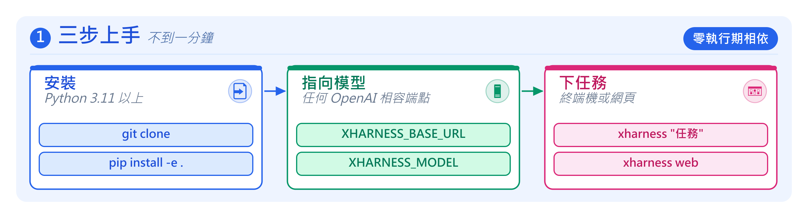
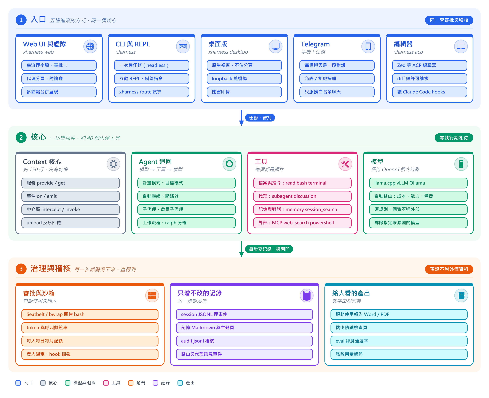
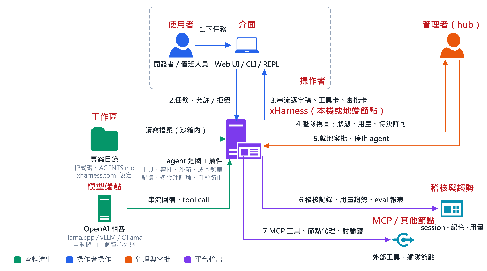
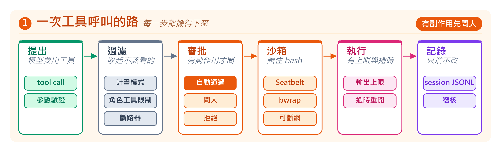
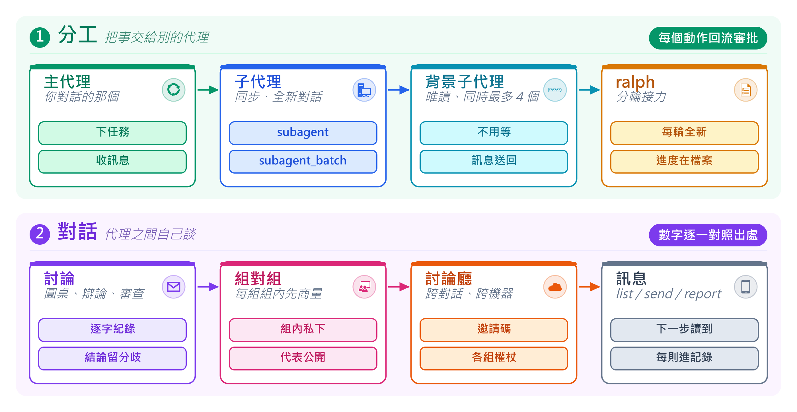
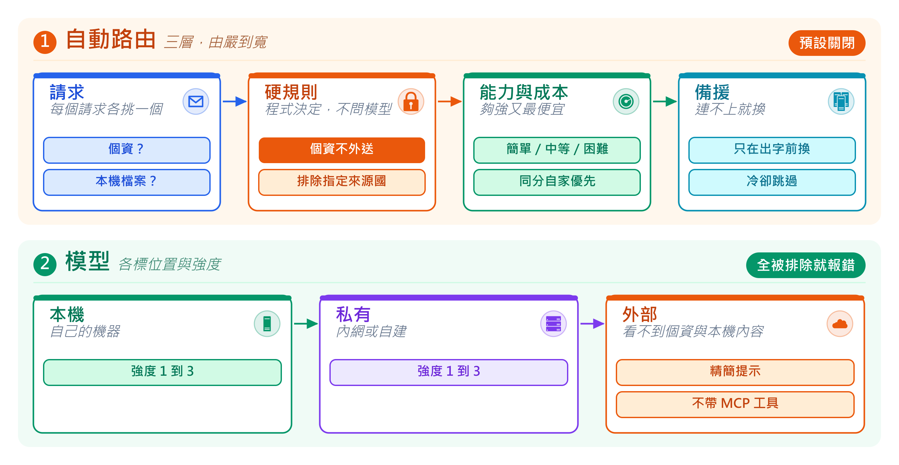
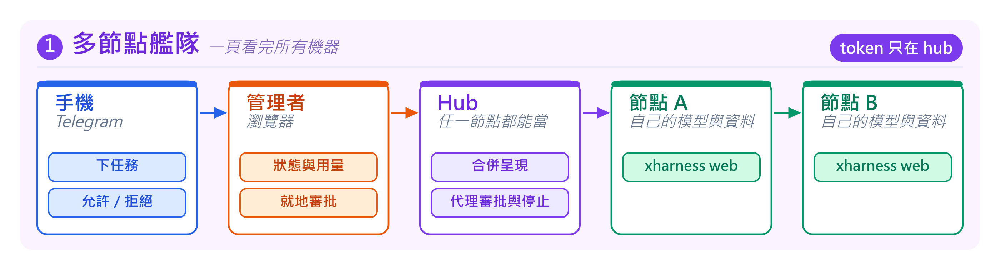
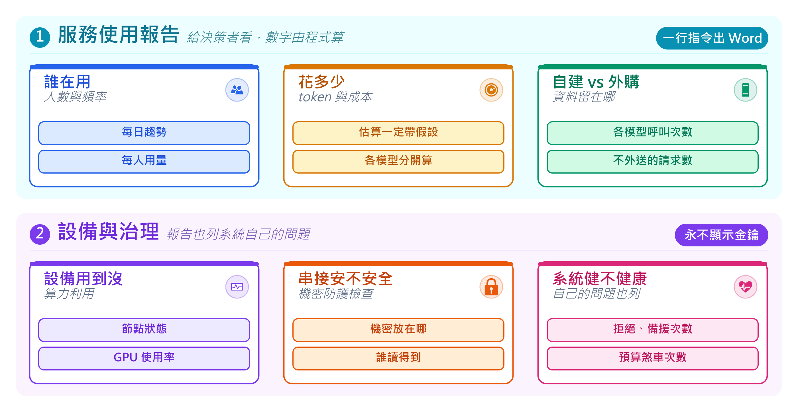

# xHarness

中文 | [English](README.en.md)

[](https://github.com/guessleej/xHarness/actions/workflows/ci.yml)
[](LICENSE)
[](pyproject.toml)

云碩科技（xCloudinfo）開發的插件式 AI agent harness：**治理優先、零執行期相依**，接任何 OpenAI 相容端點，資料不離開你的機房。約 17,500 行 Python、519 個測試。

## 三步上手



```sh
git clone https://github.com/guessleej/xHarness.git && cd xHarness
python3 -m venv .venv && ./.venv/bin/pip install -e .
XHARNESS_BASE_URL=http://localhost:8080/v1 XHARNESS_MODEL=your-model ./.venv/bin/xharness web
```

## 架構



五種入口共用同一個核心與同一套審批；核心只有約 150 行的 `Context`，其餘全是插件；每一步都被攔得下來、查得到。

## 怎麼用



## 一次工具呼叫怎麼走



## 多代理



## 自動路由



## 多節點艦隊



## 服務使用報告



## 通知頻道

任務完成、失敗或等人核准時，發訊息到 Telegram、LINE 或 Microsoft Teams。管理者在網頁「管理 > 通知頻道」新增，頁面上有每一種的取得步驟，存檔時會先向該服務驗證金鑰，再以 AES-256-GCM 加密保存（需要 `pip install 'xharness[secure]'`）。

- **Telegram** 是雙向的：授權的人可以在手機上下指令，網頁上的任務需要核准時也會收到「允許／拒絕」按鈕。新人先傳一句話給機器人，管理者在頁面上按「授權」。
- **LINE、Teams** 只通知。要能回話得有對外的 HTTPS 網址，內網節點沒有。預設不附回覆內容，只送標題與網頁連結；要附內容得逐一勾選，機密防護檢查頁會列出有勾的頻道。
- 每個頻道各自選要通知的事件，「任務完成」可設最短秒數，太快做完的不打擾。

## 內建工具

| 類別 | 工具 |
|---|---|
| 檔案與指令 | `read` `write` `edit` `glob` `grep` `bash` `terminal` `powershell` `job_*` |
| 代理 | `subagent` `subagent_batch` `ralph` `workflow` `discussion` `list_agents` `send_message` `report` |
| 記憶與對話 | `memory_*` `session_search` `session_read` `todo_write` `skill` `schedule_*` |
| 與人互動 | `ask_user` `goal_done` |
| 程式碼 | `lsp` `security_scan` |
| 設定後才有 | `web_search` `browser_open` `webfetch` 與 MCP 工具 |

## 更多

[設定範例（含全部選項與註解）](xharness.example.zh.toml) · [架構說明](docs/architecture.zh.md) · [學校部署指南](docs/deployment-school.zh.md) · [資安開發流程](docs/ssdlc.zh.md) · [安全政策](SECURITY.zh.md) · [更新紀錄](CHANGELOG.md) · MIT 授權
