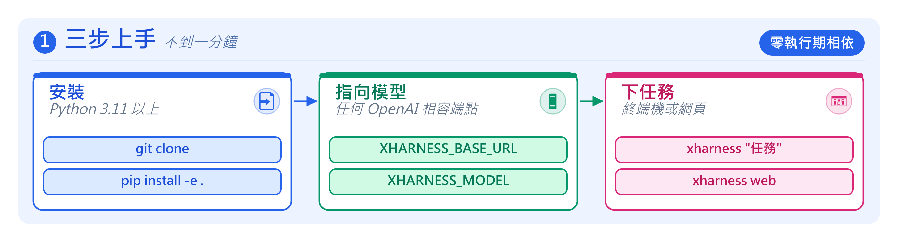
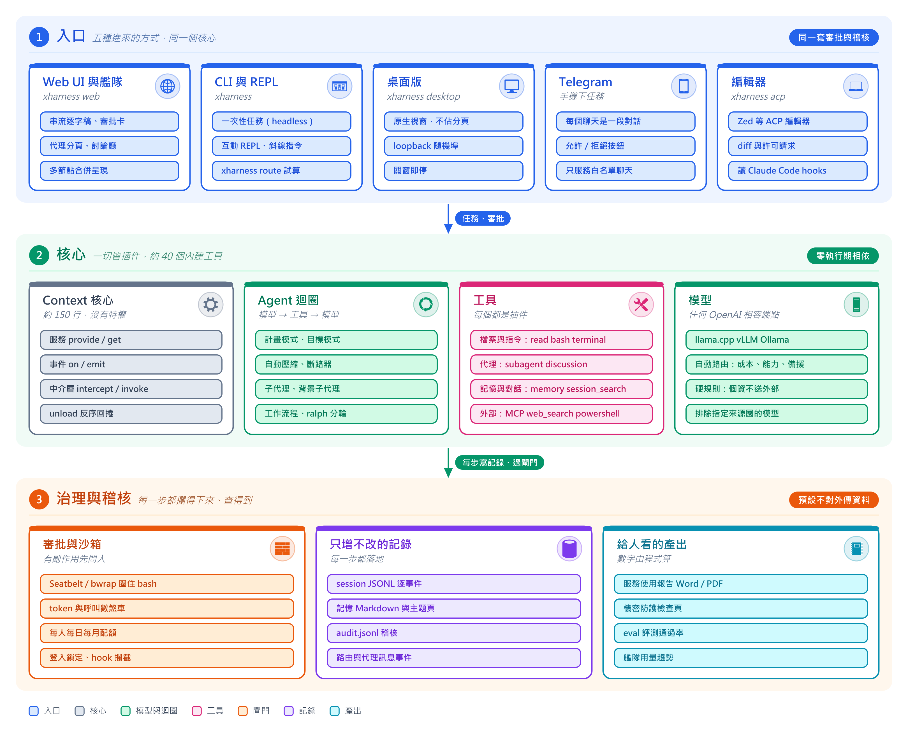
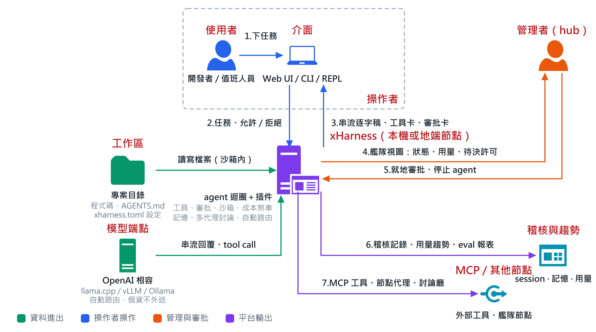
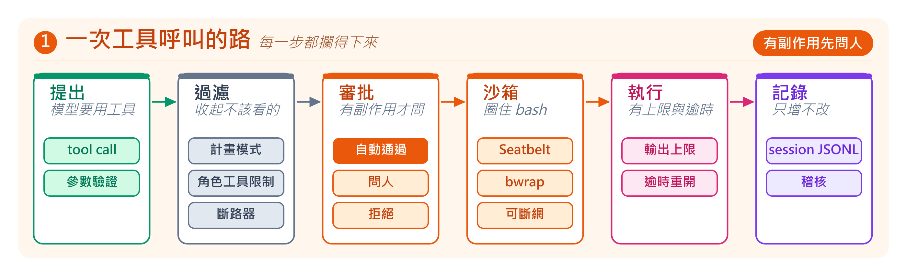
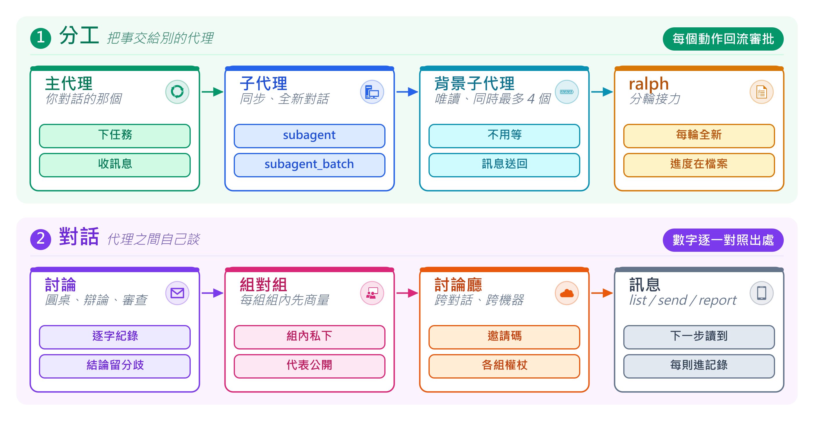
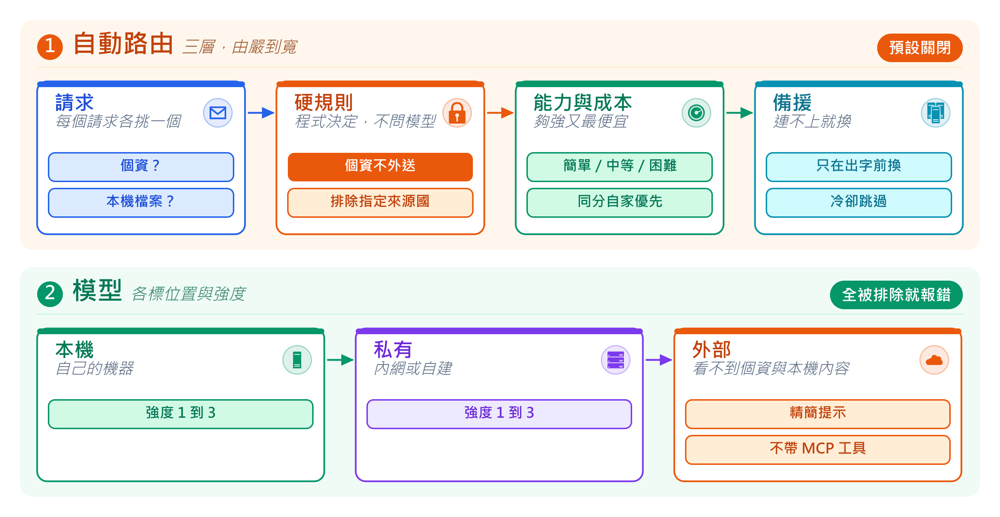
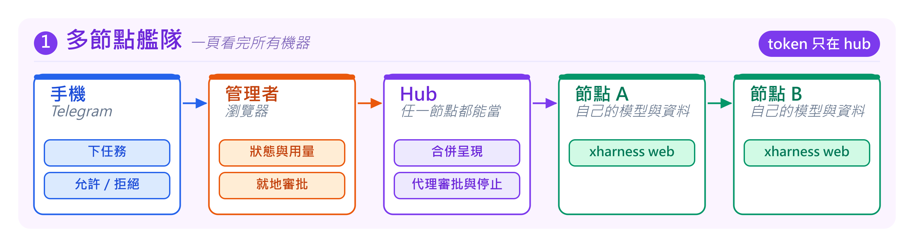
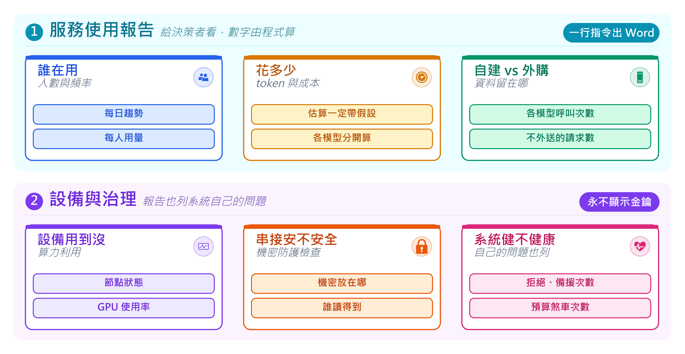

# xHarness

中文 | [English](README.en.md)

[](https://github.com/guessleej/xHarness/actions/workflows/ci.yml)
[](LICENSE)
[](pyproject.toml)

云碩科技（xCloudinfo）開發的插件式 AI agent harness：**治理優先、零執行期相依**，接任何 OpenAI 相容端點，資料不離開你的機房。約 17,500 行 Python、519 個測試。

## 三步上手



```sh
git clone https://github.com/guessleej/xHarness.git && cd xHarness
python3 -m venv .venv && ./.venv/bin/pip install -e .
XHARNESS_BASE_URL=http://localhost:8080/v1 XHARNESS_MODEL=your-model ./.venv/bin/xharness web
```

## 架構



五種入口共用同一個核心與同一套審批；核心只有約 150 行的 `Context`，其餘全是插件；每一步都被攔得下來、查得到。

## 怎麼用



## 一次工具呼叫怎麼走



## 多代理



## 自動路由



## 多節點艦隊



## 服務使用報告



## 通知頻道

任務完成、失敗或等人核准時，發訊息到 Telegram、LINE 或 Microsoft Teams。管理者在網頁「管理 > 通知頻道」新增，頁面上有每一種的取得步驟，存檔時會先向該服務驗證金鑰，再以 AES-256-GCM 加密保存（需要 `pip install 'xharness[secure]'`）。

- **Telegram** 是雙向的：授權的人可以在手機上下指令，網頁上的任務需要核准時也會收到「允許／拒絕」按鈕。新人先傳一句話給機器人，管理者在頁面上按「授權」。
- **LINE、Teams** 只通知。要能回話得有對外的 HTTPS 網址，內網節點沒有。預設不附回覆內容，只送標題與網頁連結；要附內容得逐一勾選，機密防護檢查頁會列出有勾的頻道。
- 每個頻道各自選要通知的事件，「任務完成」可設最短秒數，太快做完的不打擾。

## 常駐代理

節點上常駐一個代理（`[superagent] enabled = true`）。它自己聽 GitHub 存放庫與 Telegram 群組的事件，接下的工作交給各自隔離的工作代理去做，結果回到原本的話題或 PR；人只在要決定、要驗收時被叫。設計參考 DeepSeek 公開的 Super-agent 原型（MIT），保留 xHarness 的審批、沙箱與稽核。

- **誰能叫它由程式決定**：名單上的人點名代理，就是明確的要求。沒點名的訊息要符合團隊寫的主動規則，而且預設只「觀察」，記下本來會接的事供人核對。接單時把授權寫死在工單上，訊息內容改不了它。
- **主會話只分派，工作代理各做各的**：每張工單一個 git worktree。同一個 PR 或話題後續的訊息、CI 結果與審查留言，直接送給該工單的工作代理，不必再經過主會話。
- **PR 由系統代開**：工作代理拿不到 GitHub 權杖。系統先跑團隊的檢查指令，通過才推分支、開 PR；改了程式卻沒開 PR，不能回報完成。
- **對外寫入預設每一則都要核准**，在網頁或 Telegram 按。群組回覆上限 100 字。
- 網頁「常駐代理」頁上方是設定步驟，下面依序是待處理、工單、事件（每則訊息去了哪裡）與設定；看門狗在代理之外盯著卡住或繞圈的工作。

## 把工具開給其他 agent（MCP）

`xharness mcp-serve` 以 stdio 的 MCP 伺服器提供瀏覽器、`python_run` 與桌面操作工具，Claude Code 等 MCP 用戶端可以直接呼叫。一般動作由用戶端自己的核准把關；送出、付款這類動作與桌面操作，會用 MCP 的 elicitation 再問一次人，用戶端不支援就拒絕。`[mcp_serve] tools = [...]` 可改要提供哪些工具。

```bash
claude mcp add xharness -- xharness mcp-serve
```

## 接受其他代理平台交辦（A2A）

`xharness a2a-serve` 以 A2A 0.3 協定接受其他代理平台的工作：代理名片在 `/.well-known/agent-card.json`，要 Bearer 權杖（`$XHARNESS_HOME/a2a-token`）。需要核准時任務會停在 `input-required`，回「允許」才繼續；要人親自做的動作（桌面、送出表單）在這裡一律不給。只聽本機，要從別台連請放在 TLS 前端後面。

## 內建工具

| 類別 | 工具 |
|---|---|
| 檔案與指令 | `read` `write` `edit` `glob` `grep` `bash` `python_run`（算數字用程式算，不帶機密環境變數）`chart`（長條、橫條、折線圖，公司色盤）`terminal` `powershell` `job_*` |
| 代理 | `subagent` `subagent_batch` `ralph` `workflow`（皆可 `isolate` 獨立工作區＋`check` 整合閘門）`discussion` `list_agents` `send_message` `report` |
| 任務板（`[board]`） | `board_list` `board_add` `board_claim` `board_heartbeat` `board_release` `board_note` `board_notes` |
| 記憶與對話 | `memory_*` `session_search` `session_read` `todo_write` `skill` `schedule_*` |
| 與人互動 | `ask_user` `goal_done` |
| 程式碼 | `lsp` `security_scan` |
| 設定後才有 | `web_search` `browser_open` `browser_view` `browser_click` `browser_type` `browser_press` `browser_scroll` `browser_tabs`（在背景瀏覽器裡點、填、送出；送出、付款、登入、刪除、下載一律先問人）`webfetch` `desktop_look` `desktop_act`（操作這台電腦，macOS 與 Windows，每次都問人）與 MCP 工具 |

## 更多

[設定範例（含全部選項與註解）](xharness.example.zh.toml) · [架構說明](docs/architecture.zh.md) · [學校部署指南](docs/deployment-school.zh.md) · [資安開發流程](docs/ssdlc.zh.md) · [安全政策](SECURITY.zh.md) · [更新紀錄](CHANGELOG.md) · MIT 授權
